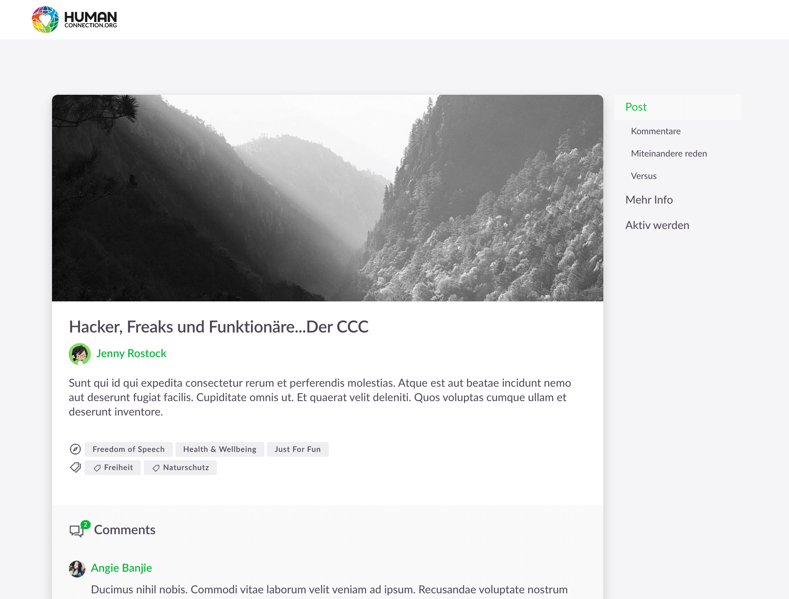

# Webapp



## Installation

For preparation you need a recent version of
[Node](https://nodejs.org/en/). The version we build and test against is pinned in
[`.nvmrc`](.nvmrc), and the commands below read it — so there is one place to change it. You can use
[node version manager](https://github.com/nvm-sh/nvm) `nvm` to switch
between different local Node versions:

```bash
# install Node using '.nvmrc' file
$ cd webapp
$ nvm install
$ nvm use
```

Install node dependencies with [npm](https://www.npmjs.com/):

```bash
# install all dependencies
$ cd webapp
$ npm ci
# or later on, to use the Node version from ".nvmrc"
$ nvm use && npm ci
```

`npm ci` installs exactly what `package-lock.json` pins and is what CI and the Docker images run.
Use `npm install` only when you are adding or changing a dependency — unlike `npm ci`, it may rewrite
the lockfile.

Copy:

```text
# in webapp
cp .env.template .env
```

Configure the files according to your needs and your local setup.

### Build for Development

```bash
# serve with hot reload at localhost:3000
$ npm run dev
```

### Build for Production

```bash
# build for production and launch server — NODE_ENV=production is what turns on the production
# settings of nuxt.config.js (the CSS as cacheable files, the modern build); the Docker image sets it
$ NODE_ENV=production npm run build
$ NODE_ENV=production npm run start
```

### Run tests

We ensure the quality of our frontend code by using
- [ESLint](https://eslint.org/) for checking our JavaScript code
- [Jest](https://jestjs.io/) and [Vue Test Utils](https://vue-test-utils.vuejs.org/) to unit test our components
- [Storybook](https://storybook.js.org/) to document and manually test our components in an isolated playground

For more information see our [frontend testing guide](testing.md). Use these commands to run the tests:

#### With Docker

After starting the application following the above guidelines, open new terminal windows for each of these commands:

```bash
# run eslint
$ docker-compose exec webapp npm run lint
```

```bash
# run unit tests
$ docker-compose exec webapp npm test
```

```bash
# start storybook
$ docker-compose exec webapp npm run storybook
```

You can then visit the Storybook playground on `http://localhost:3002`

#### Without Docker

After starting the application following the above guidelines, open new terminal windows and navigate to the `/webapp` directory for each of these commands:

```bash
# run eslint in /webapp (use option --fix to normalize the files)
$ npm run lint
```

```bash
# run unit tests in /webapp
$ npm test
```

```bash
# start storybook in /webapp
$ npm run storybook
```

You can then visit the Storybook playground on `http://localhost:3002`

## Translations

The texts live in `locales/<language>.json`, one file per language, all with the same keys.
`en.json` is the reference. `npm run lint` checks them (eslint-config-it4c's `vueI18n` module):

- every key the code asks for with `$t('…')` exists,
- every language has exactly the keys of the others,
- no key is left that nothing uses any more,
- the keys are sorted. `npm run lint -- --fix` sorts them.

A new text therefore goes into all languages at once, in English where no translation exists yet.
A key the code builds at runtime (`` $t(`group.types.${type}`) ``) or hands over as
data (a modal's `titleIdent`) is invisible to the unused-keys check: add its pattern to `ignores`
in `eslint.config.mjs`, next to the others of its kind. Where the key is a choice between a few
literals, prefer `cond ? $t('a') : $t('b')` over `` $t(cond ? 'a' : 'b') ``: then the lint sees both.

The unit tests add a check of their own (`test/knownTranslationKeys.js`): a spec that renders a key
`en.json` does not define fails, including the keys built at runtime. The translations of the
backend's error codes, the permission catalogs and the admin config categories are checked against
their source by `backend/src/graphql/webappTranslations.spec.ts`.

## Maintenance Mode

For installing and running the maintenance mode see [Maintenance Mode](./maintenance/README.md).

## Styleguide Migration

We are currently in the process of migrating our styleguide components and design tokens from the [Nitro Styleguide](https://github.com/Ocelot-Social-Community/HC-Styleguide-20201003) into the main [ocelot.social repository](https://github.com/Ocelot-Social-Community/Ocelot-Social) and refactoring our components in the process. During this migration, our new components will live in a `_new/` folder to separate them from the old, yet untouched components.

### Folder Structure

The folder structure we are following is [prescribed by Nuxt.js](https://nuxtjs.org/guide/directory-structure):

- **assets** contains icons, images and logos in `svg` format and all shared SCSS files such as `tokens`
- **components** separated into two sub-folders:
    - **generic** are the generic building blocks of the app – small, reusable and usually not coupled to state
    - **features** are composed of components but tied to a particular function of the app (e.g. `comment` or `post`)
- **layouts** can use components to create layout templates for pages
- **pages** are the entry points for all `routes` in the app and are composed of layouts, features and components
